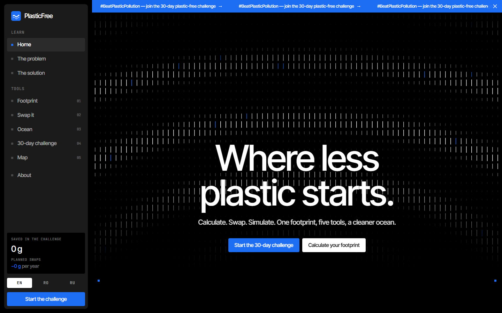
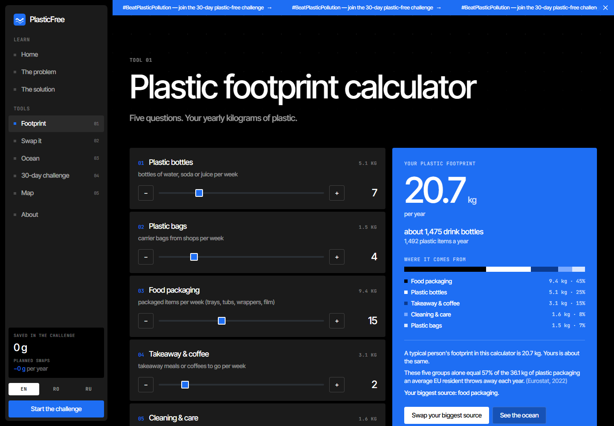
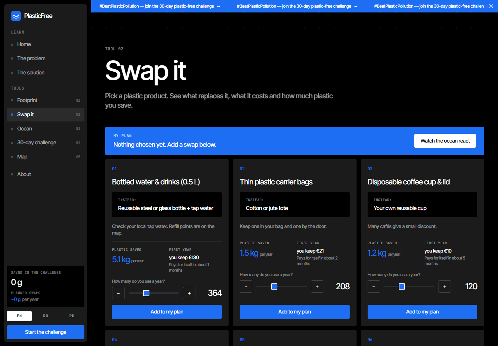
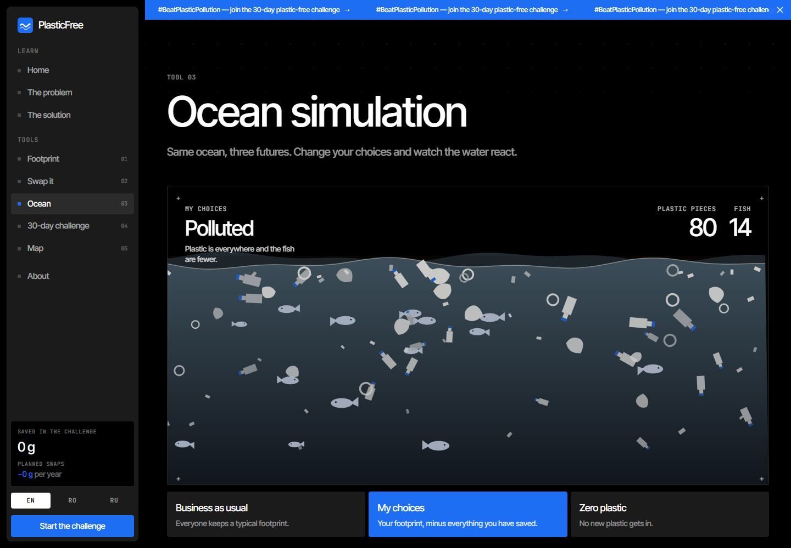
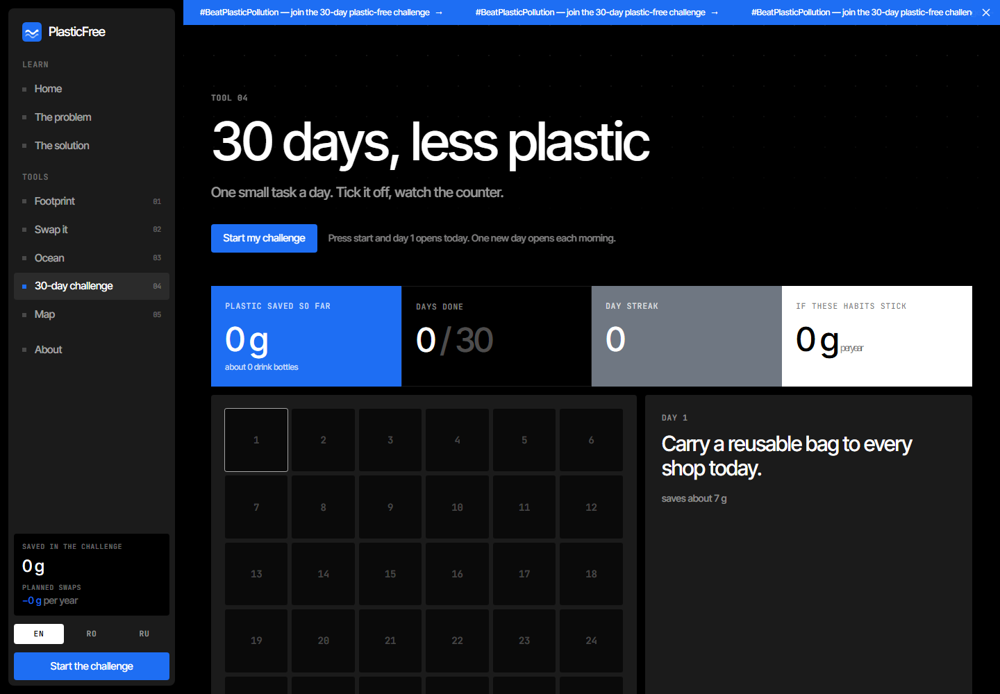
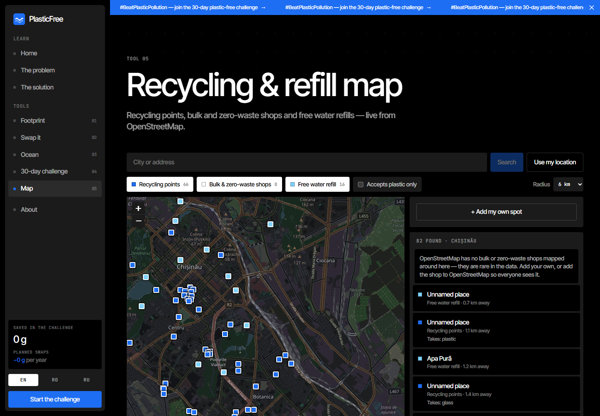
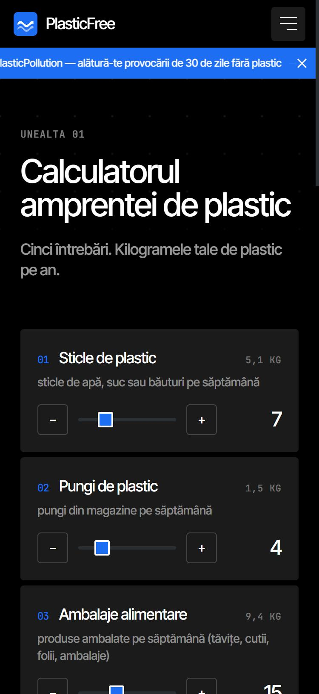
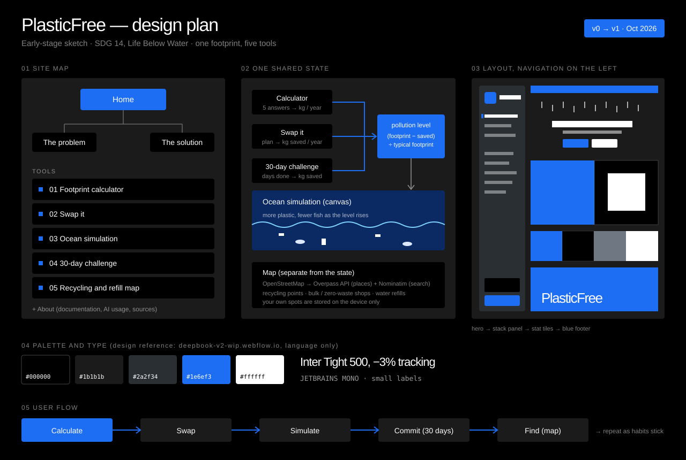

# 🌊 PlasticFree

**Every year, millions of tonnes of plastic leak into rivers and the sea, and it feels too big for one person to matter.** PlasticFree makes it personal: it measures how much plastic *you* throw away, shows the few swaps that matter most and what they cost, lets you watch an ocean fill up or clear out depending on your choices, turns it into a 30-day habit, and puts the nearest recycling points and free water refills on a map.

Built for **Sustainable Development Goal 14, Life Below Water**, and the UN's #BeatPlasticPollution campaign. Project prepared for Infomatrix, category **Software Development** (Project Contest).

### 🔴 [Try the live app → plastic-free-kappa.vercel.app](https://plastic-free-kappa.vercel.app)

### Infomatrix requirements checklist

| Requirement (Infomatrix regulations and Software Development page) | Where it is met |
|---|---|
| Entry in English | The site opens in English by default (Romanian and Russian are optional); all documentation is in English |
| At most two students and a supervisor, as distinct roles | [People involved](#2-people-involved) |
| Description with sketches or images of the idea | [Screenshots](#screenshots) and the [design plan](docs/design/plan.svg) (site map, shared state, layout, palette, user flow) |
| Early-stage plans and designs | [Early-stage plan & design decisions](#3-early-stage-plan-design-decisions--timeline) and the [design plan](docs/design/plan.svg) |
| Iterations during development | [Development timeline](#development-timeline) and the Git history |
| Software and hardware specifications | [Specifications](#5-software--hardware-specifications) |
| Problems faced and how they were solved | [Problems faced](#6-problems-faced--how-they-were-solved) |
| Open source, original work, no third-party rights infringed | Public repository under the [MIT licence](LICENSE); every third-party resource and its licence is in [Third-party content](#third-party-content--licences) |
| Documentation uploaded with the entry | This README, also as a PDF: [docs/PlasticFree-documentation.pdf](docs/PlasticFree-documentation.pdf) |
| Cite all prompts, models and AI resources | [Responsible AI](#7-responsible-ai-usage) and the full [AI usage log](docs/AI_USAGE.md), also summarised on the site's *About* page |
| A real-world problem, practical and user-friendly | [The problem](#the-problem); the app works on desktop and phone |

---

## 1. Project Description

### The problem

- About **400 million tonnes** of plastic are produced every year, and only an estimated **9%** of all plastic ever made has been recycled ([UNEP, *Drowning in Plastics*, 2021](https://www.unep.org/resources/report/drowning-plastics-marine-litter-and-plastic-waste-vital-graphics))
- Estimates of how much reaches the ocean each year range from about **1.7 million tonnes** ([OECD data via Our World in Data](https://ourworldindata.org/how-much-plastic-waste-ends-up-in-the-ocean), 2019) to about **11 million tonnes**, rising toward 29 million by 2040 if nothing changes (UNEP, 2021). Methods differ and the figures are uncertain; both say it has to go down.
- A 2016 report by the Ellen MacArthur Foundation and the World Economic Forum projected that, **if nothing changes, the ocean could hold more plastic than fish by weight by 2050**. A scenario, not a forecast ([source](https://weforum.org/press/2016/01/more-plastic-than-fish-in-the-ocean-by-2050-report-offers-blueprint-for-change/)).
- The average EU resident generated **36.1 kg** of plastic packaging waste in 2022 ([Eurostat](https://ec.europa.eu/eurostat/en/web/products-eurostat-news/w/ddn-20241024-3))

The problem is not a lack of awareness. It is that the numbers are global and abstract, while the plastic in one person's bin is small, daily and invisible. Nobody knows what *their* footprint is, which swaps would change it, or where to take the rest.

### The solution

Five tools, one habit:

1. **Plastic footprint calculator** — five questions (bottles, bags, food packaging, takeaway, cleaning and care) give your yearly kilograms of plastic, a breakdown by source, a comparison with a stated "typical person" and with the EU average, and your biggest source.
2. **Swap it** — twelve everyday plastic products, each with its alternative, what it costs in the first year, how soon it pays for itself and how much plastic it saves. You build a plan; quantities follow your calculator answers.
3. **Ocean simulation** — an animated ocean on a canvas. Plastic drifts in and fish disappear as your footprint rises; clean-up rings sweep pieces away as it falls. Three scenarios (business as usual, your choices, zero plastic) and a "if a school or a city did the same" multiplier.
4. **30-day challenge** — one small task a day, a locked calendar that opens a day at a time, a counter of plastic saved so far, a streak, and a projection of the yearly saving *if the habits stick*.
5. **Recycling & refill map** — recycling points (with the materials each takes, and a "takes plastic" filter), bulk and zero-waste shops, and free drinking-water points, live from OpenStreetMap for any city or for your location. Places missing from the map can be added and stay on your device.

The tools share one state: swaps and challenge progress reduce your footprint, and the ocean reacts to the result. Everything is stored in your own browser; there are no accounts.

Available in **English, Romanian and Russian**.

### How it is different

- **Honest numbers.** Every figure is either a cited statistic or labelled an estimate with its formula one click away. Where sources disagree (how much reaches the ocean), both are shown.
- **Swap prices include the downside.** A razor or a toothbrush costs more at first; the page says so instead of promising savings.
- **The map admits its gaps.** Bulk and zero-waste shops are barely mapped in OpenStreetMap; the app says so and lets you add your own.
- **No tracking, no accounts, no backend to run.**

### Screenshots



*Home — the left navigation, the animated hero and the call to action.*



*Footprint calculator — five sliders on the left, the yearly result, breakdown and comparisons on the right.*



*Swap it — alternative, first-year cost, payback and plastic saved for each product.*



*Ocean simulation — the water, plastic and fish for a typical footprint.*



*30-day challenge — a calendar that opens one day at a time, and the running counters.*



*Map — 66 recycling points and 16 free water points around Chișinău, from OpenStreetMap, with an honest note that no bulk shops are mapped there.*



*The same app on a phone, in Romanian — the navigation becomes a drawer and every tool stacks into one column.*

---

## 2. People Involved

| Role | Name |
|---|---|
| Student developer | Victor Mamaliga (GitHub: vicheaa44) |
| Supervisor | Azamat Jayush |

Team size: 1 student (solo entry), within the category's 1–2 student limit.

---

## 3. Early-Stage Plan, Design Decisions & Timeline

The project started from one framing question: *how do you make a planetary problem (ocean plastic) feel like something one person can act on, today?* Three early decisions followed:

1. **Make the footprint personal first.** The first screen after the story is a calculator, not a statistic. Everything else (swaps, ocean, challenge) is built on its number.
2. **Connect the tools through one shared state.** Swaps and challenge progress feed the same "pollution level" the ocean draws, so a choice on one page is visible on another.
3. **Use open data and no backend.** Maps and search come straight from OpenStreetMap services in the browser; personal data never leaves the device. This also keeps the project free to host.



*Early design plan — the site map, how the tools share one state, the layout with the navigation on the left, the palette and the user flow.*

The structure follows the student's earlier projects (ClimaWatch and WasteLand): a Problem page, a Solution page, interactive tools, an About page with the documentation, English / Romanian / Russian, and a test suite. The look follows a reference site, [DeepBook](https://deepbook-v2-wip.webflow.io): pure black, a single electric blue, dark panels, isometric illustrations, a split "stack" section and coloured stat tiles. Only the *visual language* was taken (palette, layout patterns, the 4 px button radius); no code, images or fonts were copied. The reference's typeface (TWK Everett) is commercial, so **Inter Tight** is used instead, with **JetBrains Mono** for small labels. The navigation sits on the **left**, as a fixed panel on large screens and a slide-in drawer on phones.

### Development timeline

This timeline follows the project's Git history.

| Date | What happened |
|---|---|
| **21 Oct 2026** | **Project and logic.** Vite + React + TypeScript scaffold, Tailwind v4 design tokens, and the tested core: footprint calculator, swap catalogue and money model, 30-day challenge, ocean level, map query and parsing, and validated local storage. |
| **21 Oct 2026** | **Interface and content.** Translations (English, Romanian, Russian), the left navigation, the animated hero, the isometric illustrations, the home page and the Problem and Solution pages. |
| **21 Oct 2026** | **The five tools.** Calculator, Swap it, Ocean simulation, 30-day challenge and the Leaflet map. Checked in a browser on desktop and phone width; the map's tile source and Overpass strategy were changed after testing (see [Problems faced](#6-problems-faced--how-they-were-solved)). |
| **21 Oct 2026** | **Documentation.** README, screenshots, About page and the AI usage log. |
| **21 Oct 2026** | **Publication.** Public GitHub repository, live deployment on Vercel (every push to `main` deploys), the student and supervisor credited, the design-plan sketch and a PDF copy of the documentation for upload. |

---

## 4. Architecture

```
Browser (React, no server of ours)
┌────────────────────────────────────────────────────────────────────┐
│  pages/            Home, Problem, Solution, Calculator, Swap,        │
│                    Ocean, Challenge, Map (lazy-loaded), About        │
│  context/          PlasticProvider: answers, swaps, challenge, spots │
│                    ── saved to localStorage, validated on load ──    │
│  utils/            footprint · swaps · challenge · ocean · map       │
│                    (pure functions, unit-tested)                     │
└───────────────┬──────────────────────────────┬─────────────────────┘
                │ POST (Overpass QL)           │ GET
                ▼                              ▼
   overpass.openstreetmap.fr          nominatim.openstreetmap.org
   overpass-api.de (fallback)         (city search)
   maps.mail.ru (fallback)            tile.openstreetmap.org (map tiles)
```

- **State.** One React context holds everything the user enters. It is saved to `localStorage` and re-validated field by field on load (`utils/storage.ts`), so a corrupted or hand-edited entry can never crash the app.
- **One shared number.** `pollutionLevel = (footprint − savings) ÷ typical footprint` feeds the ocean. It is shown on the Ocean page with every term.
- **Map data.** One Overpass query returns recycling points, drinking-water points and bulk / zero-waste shops together; the response is classified by tags. Three mirrors are tried in turn, each with a timeout, and results are cached per query.
- **No backend.** The map services are public and need no key, so there is nothing to hide and nothing to host.

---

## 5. Software & Hardware Specifications

| | |
|---|---|
| Frontend | React 19, TypeScript, Vite, Tailwind CSS v4, React Router |
| Map | [Leaflet](https://leafletjs.com) with OpenStreetMap tiles (darkened with a CSS filter), lazy-loaded as its own chunk |
| Live data | Overpass API (places), Nominatim (city search), both from OpenStreetMap, called from the browser |
| Charts & animation | Hand-written canvas (hero ripples, ocean) and SVG (isometric illustrations) — no chart or animation library |
| Chart embed | [Our World in Data](https://ourworldindata.org/grapher/plastic-waste-emitted-to-the-ocean) |
| Translations | Custom React context, English / Romanian / Russian, no external library |
| Typography | Inter Tight and JetBrains Mono (Google Fonts, SIL Open Font License) |
| Testing | Vitest |
| Hardware | None. PlasticFree is a web application; it runs in any modern browser on any device with an internet connection. The optional "use my location" button uses the browser's geolocation, only when pressed. |

### Project structure

```
src/
  components/      Sidebar, Ticker, Footer, HeroWaves, StackSection, OceanCanvas, MapView, ...
    illustrations/ Isometric toolkit (boxes, cylinders, bottles) and the seven scenes
  pages/           Home, Problem, Solution, Calculator, Swap, Ocean, Challenge, Map, About
  context/         PlasticProvider (shared state)
  hooks/           useCountUp, useInView
  i18n/            en / ro / ru translations + language context
  utils/           footprint, swaps, challenge, ocean, map, storage, format (+ tests)
  constants/       Map layer colours
```

---

## 6. Problems Faced & How They Were Solved

- **The map's dark tiles stopped working.** The first version used CARTO's free dark basemap; testing showed every tile replaced by an "API KEY REQUIRED" watermark. *Solution:* the standard OpenStreetMap tiles, darkened in CSS (`invert` + `hue-rotate`), with the required attribution.
- **The public Overpass server was too slow.** The main server answered in 30–40 seconds, and regular-expression filters made it worse. *Solution:* exact `key=value` filters only (covered by a test), one combined query instead of three, the fast `overpass.openstreetmap.fr` mirror first (about 1.5 s) with two fallbacks, a 15-second timeout per mirror and a per-query cache.
- **Bulk and zero-waste shops are almost absent from OpenStreetMap.** In Chișinău and Bucharest, the tags used for them return nothing. *Solution:* the interface says so plainly instead of showing an empty map, links to OpenStreetMap's "fix the map" page, and lets people add their own spots, which stay on their device.
- **Place names come from volunteers.** Anyone can put anything in a `name` tag. *Solution:* map popups are built from DOM nodes with `textContent`, never from HTML strings.
- **Sources disagree on how much plastic reaches the ocean.** Estimates differ by a factor of six. *Solution:* the Problem page shows both, names the sources and says the methods differ, rather than picking the scarier number.
- **Mixing yearly and one-off savings.** Swaps are yearly; the challenge counts plastic actually avoided so far. *Solution:* the ocean level formula is explicit and shown (`(footprint − swaps − challenge) ÷ typical`), and the challenge separately projects the yearly figure "if the habits stick".
- **A calculator must not invent precision.** *Solution:* every weight lives in one tested module and is listed in a "How is this calculated?" note; the "typical person" it compares against is stated openly; the About page lists the limits.
- **Honest money.** Several swaps cost more in year one. *Solution:* the card shows "costs €X more" and "pays for itself after the first year" instead of hiding it (tested for the razor).
- **Reduced motion blanked the canvases.** With `prefers-reduced-motion` the hero and ocean draw one still frame, but resizing a canvas clears it. Found while capturing screenshots. *Solution:* both redraw on resize when motion is reduced.
- **A "30 days" calendar needs real dates.** *Solution:* day numbers are computed from local calendar days (not 24-hour blocks, so daylight-saving changes cannot skip or repeat a day), a new day unlocks at midnight without reloading, and the logic is unit-tested.
- **Corrupted or hand-edited saved data.** *Solution:* `sanitizeState` rebuilds the state from whatever it finds and falls back to defaults field by field (tested).
- **A left-hand navigation on a phone.** *Solution:* a fixed panel from the `lg` breakpoint up, and on smaller screens a top bar with a slide-in drawer (closes on route change and on Escape, locks scrolling while open).
- **A commercial typeface.** The reference site uses TWK Everett. *Solution:* Inter Tight, a free tight grotesque, with the same negative tracking.

---

## 7. Responsible AI Usage

AI tools were used during development, in line with the category's rules on citing AI assistance.

- **Tool used:** [Claude Code](https://claude.com/claude-code) (Anthropic), an AI coding assistant, used as a pair-programming tool.
- **Model:** Claude Sonnet 5.5 (`claude-sonnet-5-5`).
- **Prompts:** every prompt is quoted, with what it produced and how it was checked, in [docs/AI_USAGE.md](docs/AI_USAGE.md).
- **How it was used:** scaffolding the project on the structure of the student's earlier projects, writing the TypeScript, generating the tests, translating the interface and drafting this README, from directions and requirements given by the student.
- **Human oversight:** generated code is reviewed, run and tested before being kept. Product decisions (the topic, the five tools, the left-hand navigation, the reference design) were directed by the student.
- **What was not AI-generated:** the statistics and their sources, the Our World in Data chart, the TEDxDelft talk and all map data are real external sources, credited below. There are no AI-generated images.

No AI-generated text, image or code in this project is presented as original human work without this disclosure.

---

## Running locally

```bash
npm install
npm run dev
```

No API key or `.env` file is needed.

## Testing

```bash
npm test
```

51 tests cover the footprint calculator (every category, clamping, bottle equivalents), the swap catalogue and money model (savings, payback, costs-more cases, unknown ids), the challenge (date logic, unlocking, streaks, yearly projection), the ocean model (level, counts, states, scaling), the map (query construction, layer classification, response parsing, distance, geocoding) and the validation of saved data.

```bash
npm run lint
npm run build
```

## Deployment

The live app runs on [Vercel](https://vercel.com) at **https://plastic-free-kappa.vercel.app**, connected to this repository: every push to `main` deploys automatically. It is a static single-page application, so to host your own copy import the repository in Vercel (or run `npx vercel --prod`) and deploy; `vercel.json` rewrites every route to `index.html` so direct links to inner pages work. No environment variables are needed.

## Sources

UNEP, *Drowning in Plastics: Marine Litter and Plastic Waste Vital Graphics* (2021, unep.org); Our World in Data, *How much plastic waste ends up in the ocean?* (ourworldindata.org); Eurostat, packaging waste statistics, 2024 release (ec.europa.eu/eurostat); Ellen MacArthur Foundation and World Economic Forum, *The New Plastics Economy* (2016); United Nations Sustainable Development Goal 14 (sdgs.un.org/goals/goal14); OpenStreetMap contributors (openstreetmap.org); TEDxDelft, Boyan Slat, *How the oceans can clean themselves*.

## Third-party content & licences

| Content | Licence / terms | How it is used |
|---|---|---|
| Map data from [OpenStreetMap](https://www.openstreetmap.org/copyright) | ODbL 1.0 | Places and city search, attributed on the map |
| OpenStreetMap standard tiles | [Tile usage policy](https://operations.osmfoundation.org/policies/tiles/) | Map background, attributed |
| Overpass API mirrors, Nominatim | Public services, fair use | Called once per search, results cached |
| [Leaflet](https://leafletjs.com) | BSD-2-Clause | Map library |
| Inter Tight, JetBrains Mono | SIL Open Font License | Loaded from Google Fonts |
| [Our World in Data](https://ourworldindata.org/grapher/plastic-waste-emitted-to-the-ocean) chart | CC BY 4.0 | Embedded, with credit |
| TEDxDelft talk by Boyan Slat | YouTube embed | Embedded (privacy-enhanced `youtube-nocookie.com`), with credit |
| Statistics: UNEP, Eurostat, Ellen MacArthur Foundation / WEF, UN | Cited facts | Quoted with their source next to each figure |
| React, Vite, Tailwind CSS, React Router | MIT | Dependencies (see `package.json`) |

No photographs or illustrations from other sources are used: the isometric scenes are drawn in code.

## License

[MIT](LICENSE). Open source, per Infomatrix competition rules.
